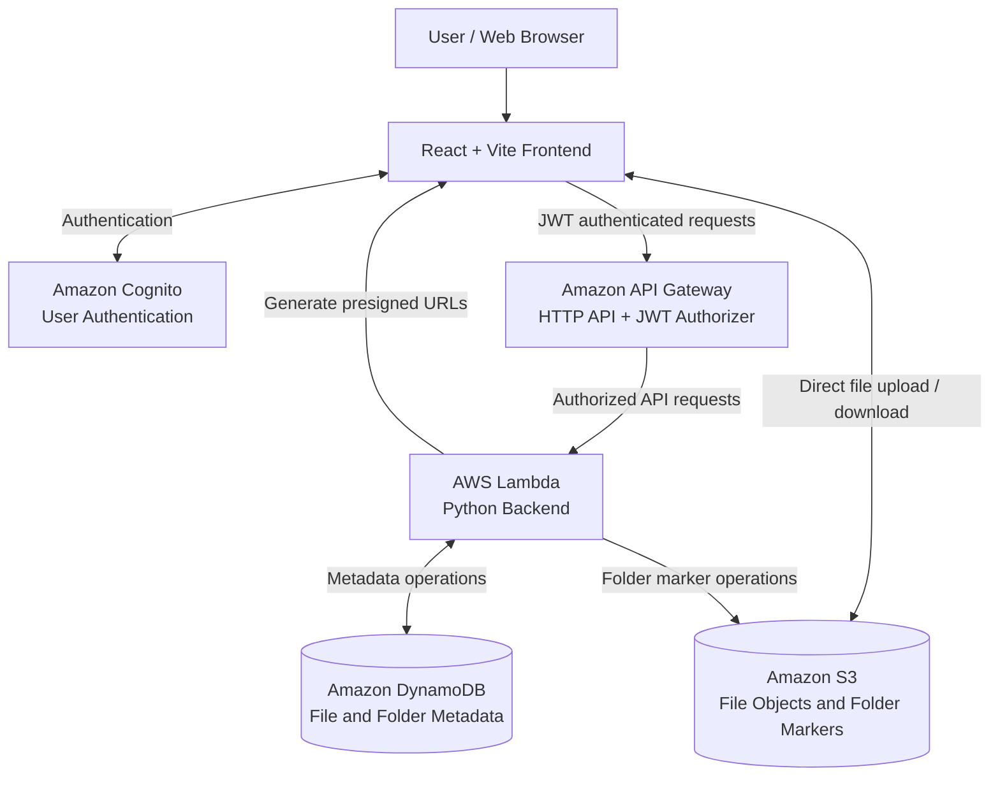

# CloudVault – Serverless Cloud File Storage System

CloudVault is a cloud-based file storage application built using React and Amazon Web Services (AWS). It provides secure user authentication, file uploads, downloads, deletion, and folder management through a serverless architecture.

The application uses Amazon S3 for file storage, Amazon DynamoDB for metadata management, Amazon Cognito for authentication, Amazon API Gateway for API access, and AWS Lambda for backend processing.

---

## Project Overview

CloudVault provides users with a simple interface to securely manage their files and folders using AWS cloud infrastructure.

### Key Features

- **User Authentication:** Registration, login, email verification, password reset, and logout using Amazon Cognito.
- **File Upload:** Upload files directly to Amazon S3 using presigned URLs.
- **File Download:** Secure file downloads using temporary presigned URLs.
- **File Management:** View and delete uploaded files.
- **Folder Management:** Create folders, view folders, navigate inside folders, and upload files into specific folders.
- **Metadata Management:** Store and retrieve file and folder metadata using Amazon DynamoDB.
- **Protected APIs:** Secure backend endpoints using JWT authorization.
- **Responsive Dashboard:** Modern interface for managing files, folders, and user profiles.

---

## Technology Stack

| Category | Technology |
|---|---|
| Frontend | React.js, Vite, CSS |
| Backend | AWS Lambda, Python |
| Authentication | Amazon Cognito |
| API Management | Amazon API Gateway |
| Object Storage | Amazon S3 |
| Database | Amazon DynamoDB |
| Security | JWT, IAM, Presigned URLs |
| Version Control | Git, GitHub |

---

## AWS Architecture

CloudVault follows a serverless architecture using AWS managed services.

### Architecture Diagram



**AWS Region:** `eu-north-1`

### AWS Services and Responsibilities

| AWS Service | Responsibility |
|---|---|
| Amazon Cognito | User registration, login, email verification, password reset, and JWT tokens |
| Amazon API Gateway | Receives frontend API requests and validates JWT tokens |
| AWS Lambda | Handles backend operations, presigned URL generation, file management, and folder management |
| Amazon S3 | Stores uploaded files and folder marker objects |
| Amazon DynamoDB | Stores file and folder metadata |

### Database Design

**DynamoDB Table:** `CloudVaultFiles`

| Attribute | Purpose |
|---|---|
| `userId` | Partition key; identifies the user |
| `fileId` | Sort key; identifies the file or folder record |
| File metadata | Stores information associated with uploaded files |
| Folder metadata | Stores information associated with folders |

Amazon S3 stores the actual file contents, while DynamoDB stores the corresponding metadata.

---

## File Upload Workflow

1. The user selects a file in the React frontend.
2. The frontend requests an upload URL through API Gateway.
3. API Gateway invokes the Lambda backend after JWT authorization.
4. Lambda generates a temporary S3 presigned upload URL.
5. The frontend uploads the file directly to Amazon S3.
6. The frontend calls the complete-upload API.
7. Lambda saves the file metadata in DynamoDB.

## File Download Workflow

1. The user requests a file download.
2. The frontend sends an authenticated request to API Gateway.
3. Lambda retrieves the file metadata from DynamoDB.
4. Lambda generates a temporary S3 presigned download URL.
5. The browser downloads the file directly from Amazon S3.

## Folder Management Workflow

1. Users create folders through the dashboard.
2. The backend processes folder operations through Lambda.
3. Folder metadata is stored in DynamoDB.
4. Folder marker objects are maintained in S3.
5. Users can open folders, navigate between folders, and upload files into selected folders.

---

## Project Structure

```text
Cloud_Vault/
│
├── backend/
│   └── Backend application files
│
├── frontend/
│   ├── public/
│   ├── src/
│   │   ├── pages/
│   │   │   ├── Dashboard.jsx
│   │   │   ├── Login.jsx
│   │   │   └── Register.jsx
│   │   ├── App.jsx
│   │   ├── index.css
│   │   └── main.jsx
│   ├── package.json
│   └── vite.config.js
│
├── storage/
├── .gitignore
└── README.md
```

*Note: Local database, uploaded test files, environment files, dependencies, and build output are excluded from Git using `.gitignore`.*

---

## API Endpoints

The application uses Amazon API Gateway HTTP API.

| Method | Endpoint | Description |
|---|---|---|
| POST | `/upload-url` | Generate an S3 upload URL |
| POST | `/complete-upload` | Save uploaded file metadata |
| GET | `/files` | Retrieve files |
| GET | `/files/{fileId}/download` | Generate a download URL |
| DELETE | `/files/{fileId}` | Delete a file |
| POST | `/folders` | Create a folder |
| GET | `/folders` | Retrieve folders |

Protected endpoints require a valid JWT access token.

---

## Local Setup and Installation

### Prerequisites

- Node.js and npm
- Python 3.11 or compatible Python environment for local backend development
- Git
- AWS account
- AWS CLI (optional)

### 1. Clone the Repository

```bash
git clone https://github.com/ShivamAtulya/Cloud_Vault.git
cd Cloud_Vault
```

### 2. Frontend Setup

```bash
cd frontend
npm install
```

Create a `.env` file inside the frontend directory:

```env
VITE_API_BASE_URL=YOUR_API_GATEWAY_URL
```

Replace the placeholder with your configured API Gateway endpoint.

Start the frontend:

```bash
npm run dev
```

### 3. AWS Configuration

Configure the required AWS resources:

- Amazon Cognito User Pool and App Client
- Amazon API Gateway HTTP API and JWT authorizer
- AWS Lambda function and execution role
- Amazon S3 bucket
- Amazon DynamoDB table

Configure the Lambda environment variables:

```env
BUCKET_NAME=YOUR_S3_BUCKET_NAME
TABLE_NAME=CloudVaultFiles
```

Ensure that the Lambda execution role has the required permissions for S3, DynamoDB, and CloudWatch Logs.

**Important:** Never upload AWS credentials, secret keys, passwords, or environment files to GitHub.

---

## Application Screenshots


---

## Security Considerations

- Authentication is handled through Amazon Cognito.
- Protected API requests use JWT authorization.
- IAM roles provide permissions to AWS Lambda.
- Presigned URLs provide temporary access to S3 objects.
- AWS credentials and environment variables are not committed to GitHub.

---

## Future Enhancements

- File sharing between users.
- File preview functionality.
- File versioning.
- Storage usage analytics.
- Advanced access control.
- File encryption and enhanced security controls.
- Search and filtering capabilities.

---

## Learning Outcomes

Through CloudVault, the project demonstrates practical implementation of:

- Serverless application architecture.
- AWS cloud storage using Amazon S3.
- NoSQL database management using DynamoDB.
- User authentication using Amazon Cognito.
- REST-style API development using API Gateway.
- Backend processing using AWS Lambda.
- Secure file transfers using presigned URLs.
- Frontend and cloud service integration.

---

## Author

**Shivam Atulya**

GitHub: [ShivamAtulya](https://github.com/ShivamAtulya)

Project Repository: [Cloud_Vault](https://github.com/ShivamAtulya/Cloud_Vault)

---

*CloudVault – Secure, scalable, and serverless cloud file storage.*
